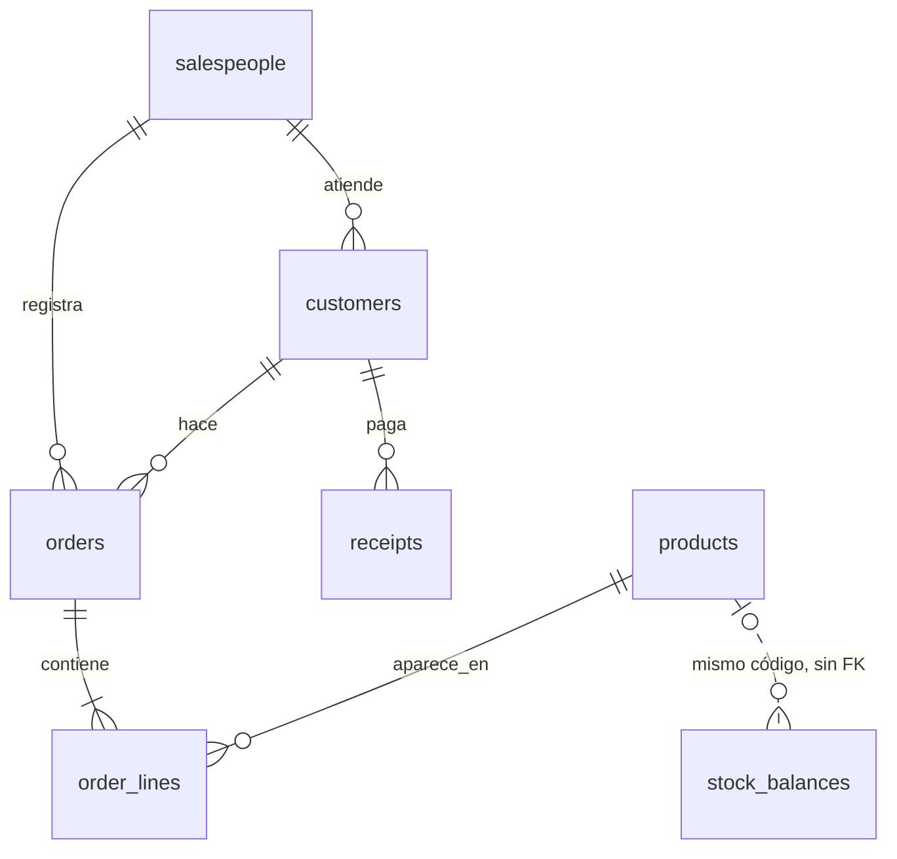

# Base de datos

PostgreSQL en Neon (producción) y SQLite (pruebas y desarrollo local). El código de acceso a datos debe funcionar
en ambos. Las columnas dudosas están en [`dudas-mederi.md`](dudas-mederi.md). La guía de la capa de infraestructura
está en [`infraestructura.md`](infraestructura.md).

## Tablas de Defontana (solo lectura para los módulos)

Vienen de los 7 CSV del ERP Defontana de Mederi (sin encabezados). Las escribe solo la carga de CSV (upsert).
ORM en `app/infrastructure/db/source_models.py`.

| Tabla | Clave primaria | FK | Origen | Filas |
|---|---|---|---|---|
| salespeople | code | — | 7_vendedores.csv | 6 |
| customers | ruc | salesperson_code | 1_clientes.csv | 1 330 |
| products | code | — | 4_productos.csv | 115 |
| orders | order_no | ruc, salesperson_code | 2_pedidos.csv | 14 945 |
| order_lines | id (+ único order_no, line_no, dup_seq) | order_no, product_code | 3_detalle.csv | 67 403 |
| stock_balances | warehouse_code, year, month, product_code | ninguna | 5_kardex.csv | 9 970 |
| receipts | receipt_no, document_no | ruc | 6_cobros.csv | 14 082 |

### Decisiones que no hay que deshacer
- Los códigos se guardan como texto con ceros a la izquierda (`'001'`).
- `receipts` no se enlaza con `orders`: el CSV trae el número de comprobante, no el de pedido.
- `stock_balances` no tiene FK a `products`: 5 códigos del kardex no están en el catálogo.
- `order_lines.dup_seq` conserva los 18 pares (pedido, línea) repetidos.
- Importes `Numeric(14,2)`, cantidades `Numeric(14,4)` y precio unitario `Numeric(18,10)`.
- `order_lines.line_total = quantity × unit_price × (1 − discount_pct/100)`, sin IGV (verificado en las 67 403 líneas).

### Columnas derivadas (las calcula el cargador)

| Columna | Regla |
|---|---|
| customers.tax_id_kind | RUC de 11 dígitos que empieza con 20 = `company`; con 10, 15 o 17 = `person`; si no, `other` |
| products.prefix | Primeros 3 caracteres del código |
| products.is_core_product | `prefix == 'MED'` (línea veterinaria). Camas, autos, eventos, mantas, paños y revistas quedan fuera de métricas |
| orders.is_dispatched | `status_code == 'T'` |
| order_lines.is_bonus | `unit_price <= 0.01` (precio simbólico, 29 % de las líneas) |
| stock_balances.period_end | Último día del mes |

### Estado del pedido (`orders.status_code`)
T = En tránsito, A = Almacén / Aprobado, C = Cancelado, D = Devuelto / Entregado, vacío = sin dato.
Duda abierta: T es el 92 % de los pedidos, así que probablemente incluye pedidos ya entregados.

### Mapa CSV → columna
`cN` es la posición de la columna, desde 0. Las columnas que no aparecen no se guardan: están vacías, son constantes
o repiten datos de otra tabla (por ejemplo, el nombre del cliente en pedidos).

| Archivo | Columnas guardadas |
|---|---|
| 7_vendedores | c0 code, c1 name, c2 location, c4 is_active |
| 1_clientes | c0 ruc, c1 name, c2 address, c3 phone, c4 email, c5 salesperson_code, c7 department_code, c8 department, c9 segment_code, c11 condition_code, c14 is_active |
| 4_productos | c0 code, c1 name, c2 alias, c3 category_code, c5 unit_code, c10 is_active |
| 2_pedidos | c0 order_no, c1 order_date, c2 ruc, c4 salesperson_code, c6 channel_code, c7 subtotal, c8 discount, c9 tax, c10 total, c11 status_code |
| 3_detalle | c0 order_no, c4 line_no, c5 product_code, c7 unit_code, c8 quantity, c9 quantity_dispatched, c11 unit_price, c12 discount_pct, c13 line_total |
| 5_kardex | c0 warehouse_code, c1 year, c2 month, c3 product_code, c4 product_name, c5 balance |
| 6_cobros | c0 receipt_no, c1 receipt_date, c2 ruc, c4 type_code, c5 document_no, c6 code_c6, c7 payment_method_code, c8 code_c8, c9 reference_no, c10 amount, c11 applied_date |

## Política de campos vacíos

Se aplica en `app/infrastructure/loaders/defontana_csv.py`:
- Un texto opcional vacío (`""` o solo espacios) se guarda `NULL`, nunca `""`.
- Un dato obligatorio vacío o inválido (RUC, fecha, importe, producto, vendedor) rechaza la fila y se cuenta con su motivo.
- Una FK que no existe en la tabla padre rechaza la fila. Solo se valida donde los datos reales cumplen la FK al 100 %.
- Las columnas 100 % vacías o constantes no se guardan.
- Nunca se rellena un dato faltante con promedios ni con datos de otra tabla.
- La carga hace upsert por clave (`INSERT ... ON CONFLICT DO UPDATE`) y nunca borra.

Resultado con los CSV reales (verificado en SQLite y en PostgreSQL 18): **0 filas rechazadas**.
Avisos: 135 teléfonos y 112 correos vacíos, 5 condiciones vacías, 1 departamento vacío, 5 ubicaciones de vendedor
vacías, 95 alias vacíos, 14 pedidos sin estado, 18 líneas repetidas, 6 nombres de producto vacíos y 22 saldos
negativos en el kardex, y 14 025 referencias de cobro vacías.

## Tablas propias de la app

Cada una vive en el `infrastructure/orm.py` de su módulo. Las del esqueleto plano (`users`, `contacts`, `quotes`,
`quote_lines`, `customer_tiers`, `customer_rebates`) se reemplazan al pasar cada módulo a capas.

| Tabla | Módulo | Contenido |
|---|---|---|
| users | auth | id, email (único), password_hash, full_name, phone, role, salesperson_code (FK), active |
| alerts | customers | Una por cliente y día: ruc, fecha, probabilidad, dinero en juego, motivos, producto habitual, producto cruzado |
| contacts | customers | ruc, usuario, alerta (opcional), resultado, fecha |
| pricing_settings | settings | Tasa de IGV, días de vigencia, margen mínimo, rebaja en promociones |
| customer_levels | settings | level (PK: A, B, C), max_discount_pct, margin_pct, credit_days |
| level_thresholds | settings | Monto mínimo de 12 meses para B y para A |
| quotations | quotations | ruc, usuario, estado (issued/converted/expired), aprobación, valid_until, order_no, totales |
| quotation_lines | quotations | Producto, cantidad, precio de referencia y su origen |
| import_suggestions | import_planning | Producto, proveedor (opcional), cantidad sugerida, pedir antes de, decisión, data_origin |
| data_imports | data_imports | Fuente, origen, estado (staged/confirmed/cancelled), filas leídas, filas con error, fechas |

## DDL

`docs/schema.postgres.sql` se genera con `python -m scripts.export_ddl` desde el ORM. Se probó contra PostgreSQL 18:
aplica sin errores. Hasta que exista Alembic, las tablas se crean con `create_all`.
